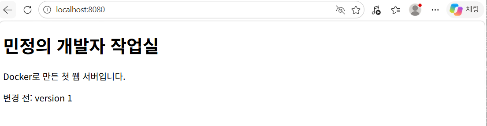
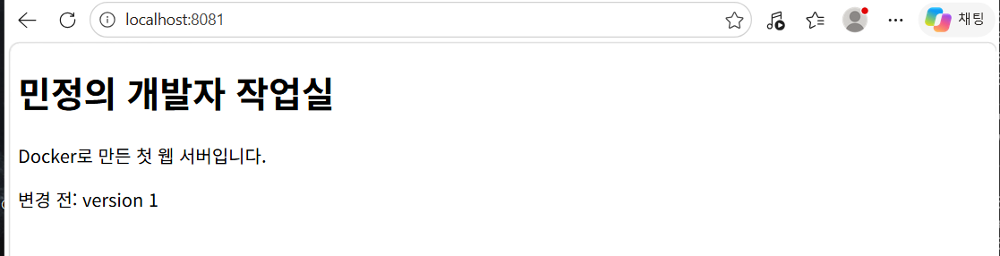
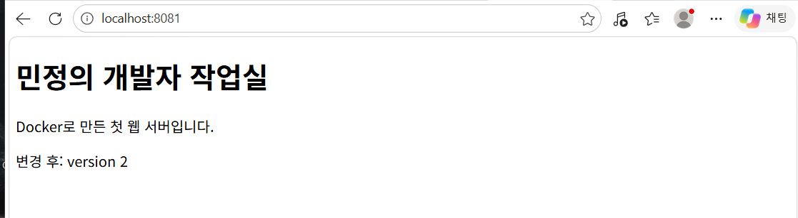
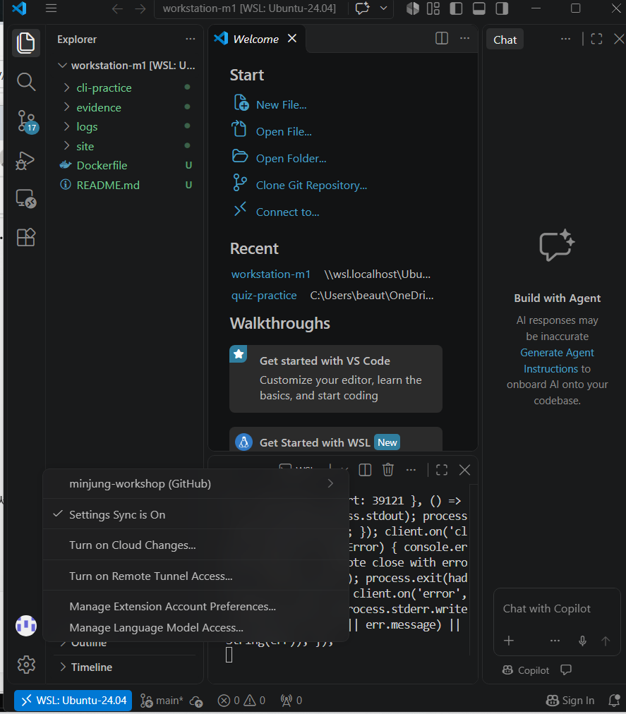

# 민정의 개발자 작업실

WSL 2 Ubuntu에서 CLI 기본 조작, 파일 권한, Docker 컨테이너, 웹 서버, 바인드 마운트와 볼륨 영속성을 실습한 기록입니다.

## 1. 실행 환경

- 호스트: Windows
- Linux: WSL 2, Ubuntu 24.04
- CPU 아키텍처: ARM64(aarch64)
- 터미널: Windows Terminal
- Shell: Bash 5.2.21
- Docker: 29.1.3
- Git: 2.43.0
- 작업 경로: /home/minjung/workstation-m1
- Docker Desktop 대신 Ubuntu에 설치한 Docker Engine을 사용했습니다.

[실행 환경 확인 로그](logs/07-environment.txt)

## 2. 수행 체크리스트

- [x] CLI 기본 명령어와 폴더 구성
- [x] 파일과 디렉터리 권한 변경
- [x] Docker 설치 및 상태 확인
- [x] hello-world 실행
- [x] Ubuntu 컨테이너 실행
- [x] exec와 attach 비교
- [x] Dockerfile 직접 작성 및 이미지 빌드
- [x] 8080·8081 포트 매핑과 브라우저 접속
- [x] 바인드 마운트 변경 반영
- [x] 볼륨 영속성 확인
- [x] Git 설정 및 VS Code GitHub 연동

## 3. 수행 로그

각 로그에는 실제 입력한 명령어와 출력 결과가 포함되어 있습니다.
script 명령으로 기록하여 터미널 제어 문자가 일부 포함될 수 있습니다.
민감정보를 잘못 입력한 부분은 제출 전 삭제했습니다.

| 실습 | 로그 |
|---|---|
| Docker 버전 및 서버 정보 | [01-docker-check.txt](logs/01-docker-check.txt) |
| CLI 및 권한 변경 | [02-cli-permissions.txt](logs/02-cli-permissions.txt) |
| 컨테이너 조작 | [03-docker-operations.txt](logs/03-docker-operations.txt) |
| 웹 이미지 빌드 및 실행 | [04-web-build.txt](logs/04-web-build.txt) |
| 바인드 마운트 | [05-bind-mount.txt](logs/05-bind-mount.txt) |
| 볼륨 영속성 | [06-volume.txt](logs/06-volume.txt) |
| 실행 환경 | [07-environment.txt](logs/07-environment.txt) |

## 4. CLI 및 권한 실습

pwd, mkdir, cd, touch, ls -la, cat, cp, mv, rm을 실행했습니다.
.hidden 파일을 만들어 ls -la로 숨김 파일까지 확인했습니다.

- 절대 경로: /home/minjung/workstation-m1
- 상대 경로: 현재 폴더를 기준으로 한 site/index.html 등
- 점 하나(.): 현재 디렉터리
- 점 두 개(..): 상위 디렉터리

note.txt는 600으로 변경한 후 644로 복원했습니다.
permissions 디렉터리는 700으로 변경한 후 755로 복원했습니다.
변경 전후 결과는 CLI 로그에 기록했습니다.

| 권한 | 표시 | 의미 |
|---|---|---|
| 파일 600 | -rw------- | 소유자만 읽기·쓰기 |
| 파일 644 | -rw-r--r-- | 소유자는 읽기·쓰기, 나머지는 읽기 |
| 디렉터리 700 | drwx------ | 소유자만 목록 조회·변경·접근 |
| 디렉터리 755 | drwxr-xr-x | 소유자는 모든 권한, 나머지는 목록 조회·접근 |

r=4, w=2, x=1입니다.
디렉터리의 x는 해당 경로에 접근하고 통과하는 권한입니다.

## 5. 컨테이너 조작

hello-world 실행으로 Docker 동작을 확인했습니다.
ubuntu:24.04 이미지를 내려받아 컨테이너 안에서 pwd, ls, echo를 실행했습니다.

- mj-ubuntu: bash에서 exit하면 주 프로세스가 종료되어 컨테이너도 정지했습니다.
- mj-keep: sleep infinity를 주 프로세스로 실행했습니다.
- exec로 실행한 별도의 bash에서 나와도 mj-keep은 계속 실행됐습니다.
- mj-attach: 주 프로세스인 bash에 attach한 뒤 exit하자 컨테이너가 정지했습니다.

docker images, ps, ps -a, stop, start, logs,
stats --no-stream 명령으로 이미지와 컨테이너 상태를 확인했습니다.

## 6. 직접 작성한 Dockerfile

[Dockerfile 보기](Dockerfile) · [웹페이지 소스 보기](site/index.html)

```dockerfile
FROM nginx:alpine
LABEL org.opencontainers.image.title="minjung-workstation"
ENV APP_ENV=practice
COPY site/ /usr/share/nginx/html/
EXPOSE 80
```

- FROM: Nginx 기반 이미지 선택
- LABEL: 작업실 이미지의 제목 지정
- ENV: 실습 환경 변수 지정
- COPY: 직접 작성한 웹페이지를 이미지에 포함
- EXPOSE: 컨테이너에서 사용하는 포트 명시

EXPOSE만으로 호스트 포트가 열리지는 않으며,
실행할 때 -p로 포트를 연결했습니다.

## 7. 포트 매핑 및 브라우저 증거

| 호스트 주소 | 컨테이너 포트 | 확인 내용 |
|---|---|---|
| http://localhost:8080 | 80 | 이미지에 포함된 웹페이지 |
| http://localhost:8081 | 80 | 바인드 마운트한 웹페이지 |

### 8080 접속



### 8081 변경 전



### 8081 변경 후



호스트의 site/index.html을 수정하자 8081 페이지가
“변경 전: version 1”에서 “변경 후: version 2”로 바뀌었습니다.
이미지를 다시 빌드하거나 컨테이너를 재시작하지 않았습니다.

8080 컨테이너는 이미지에 복사된 파일을 사용하므로
호스트 파일 수정만으로 내용이 바뀌지 않았습니다.

현재 저장소의 HTML은 실습 후 상태인 version 2입니다.
따라서 현재 소스로 새로 빌드하면 8080도 version 2가 표시됩니다.
위 version 1 캡처는 최초 빌드 당시의 실제 결과입니다.

## 8. 웹 서버 재현 절차

Docker가 설치되어 실행 중인 Ubuntu의 Bash에서 진행합니다.
저장소를 내려받은 후 Dockerfile이 있는 폴더로 이동합니다.

아래 절차는 같은 이름의 컨테이너가 없는 환경을 기준으로 합니다.
이름이 이미 사용 중이면 새 이름을 지정하세요.
8080·8081 포트가 사용 중이면 다른 호스트 포트를 지정하고
브라우저 주소도 함께 변경하세요.

```bash
sudo docker build -t minjung-web:1.0 .

sudo docker run -d --name mj-web \
  -p 127.0.0.1:8080:80 minjung-web:1.0

curl http://localhost:8080

sudo docker run -d --name mj-bind \
  -p 127.0.0.1:8081:80 \
  --mount "type=bind,source=$PWD/site,target=/usr/share/nginx/html,readonly" \
  minjung-web:1.0

curl http://localhost:8081
```

브라우저에서 http://localhost:8080 및 http://localhost:8081에 접속합니다.
컨테이너 시작 직후 접속이 안 되면 잠시 후 다시 시도합니다.

바인드 마운트 반영을 확인하려면 다음 명령으로 호스트 파일을 수정합니다.

```bash
nano site/index.html
```

본문 문구를 변경하고 저장한 뒤 다음 명령을 실행합니다.

```bash
curl http://localhost:8081
curl http://localhost:8080
```

8081에는 수정 내용이 반영되고, 8080에는 빌드 당시 내용이 남습니다.

$PWD는 현재 작업 폴더의 절대 경로이므로,
개인 경로 /home/minjung을 다른 사용자의 경로로 고칠 필요가 없습니다.
반드시 저장소 루트에서 실행해야 합니다.
Windows PowerShell이 아닌 Ubuntu Bash 기준 명령입니다.

## 9. 볼륨 영속성 검증

실제 실습에서 실행한 절차입니다.
재현 시 같은 이름의 컨테이너가 있다면 다른 이름을 사용하세요.

```bash
sudo docker volume create mj-data

sudo docker run -d --name mj-vol1 \
  -v mj-data:/data ubuntu:24.04 sleep infinity

sudo docker exec mj-vol1 sh -c \
  'echo minjung-volume-proof > /data/proof.txt; cat /data/proof.txt'

sudo docker rm -f mj-vol1

sudo docker run -d --name mj-vol2 \
  -v mj-data:/data ubuntu:24.04 sleep infinity

sudo docker exec mj-vol2 cat /data/proof.txt

sudo docker volume inspect mj-data
```

컨테이너 삭제 전과 새 컨테이너 생성 후 모두 다음 내용이 출력됐습니다.

```text
minjung-volume-proof
```

데이터가 컨테이너와 별도로 관리되는 볼륨에 남아 있음을 확인했습니다.

## 10. 문제 해결 기록

### 문제 1: 폴더 경로를 입력하자 Is a directory 발생

- 문제: pwd 결과로 나온 폴더 경로를 명령처럼 입력했습니다.
- 가설: 이동할 경로를 실행하려고 해서 오류가 발생한 것으로 판단했습니다.
- 확인: pwd로 현재 위치가 이미 workstation-m1임을 확인했습니다.
- 해결: 폴더 이동에는 cd를 사용하고, 경로 출력 자체는 명령으로 실행하지 않았습니다.

### 문제 2: sudo 비밀번호 인증 실패

- 문제: sudo 명령 실행 시 비밀번호 인증이 반복해서 실패했습니다.
- 가설: Ubuntu 사용자 비밀번호를 잘못 입력한 것으로 판단했습니다.
- 확인: sudo에서 incorrect password attempts 메시지가 나왔습니다.
- 해결: 별도 Windows PowerShell에서 아래 명령으로 Ubuntu 사용자 비밀번호를 재설정했습니다.

```powershell
wsl -d Ubuntu-24.04 -u root -- passwd minjung
```

재설정 후 sudo docker volume create mj-data가 정상 실행됐습니다.
비밀번호 입력 중에는 글자나 별표가 표시되지 않는다는 점도 확인했습니다.
실제 비밀번호는 문서에 기록하지 않았습니다.
다른 환경에서는 배포판 이름과 사용자 이름을 해당 환경에 맞게 변경해야 합니다.


### 참고: favicon.ico 404

브라우저가 요청한 favicon.ico 파일이 없어 404가 기록됐습니다.
웹페이지 본문 요청은 HTTP 200이었으며 정상 표시됐습니다.

## 11. Git 설정

이름과 비공개 이메일을 설정하고 기본 브랜치를 main으로 지정했습니다.

[Git 설정 명령어와 결과](logs/08-git-setup.txt)

## 12. VS Code GitHub 연동

WSL 확장으로 Ubuntu 작업 폴더를 열고 minjung-workshop 계정으로 로그인했습니다.



## 13. GitHub 저장소 제출

저장소: https://github.com/minjung-workshop/workstation-m1

[저장소 생성 및 업로드 수행 로그](logs/09-github-publish.txt)

다른 환경에서는 아래 명령어로 내려받은 뒤 README의 재현 절차를 진행합니다.

```bash
git clone https://github.com/minjung-workshop/workstation-m1.git
cd workstation-m1
```
